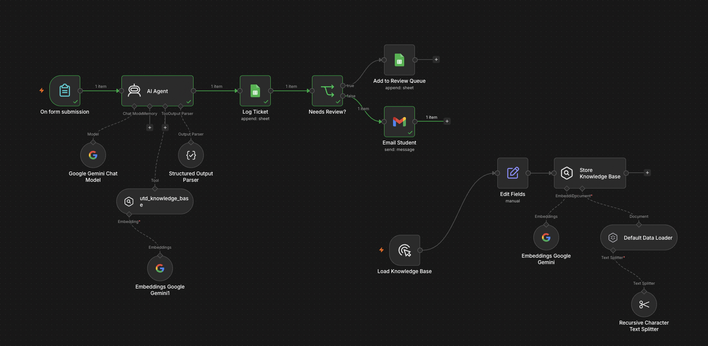
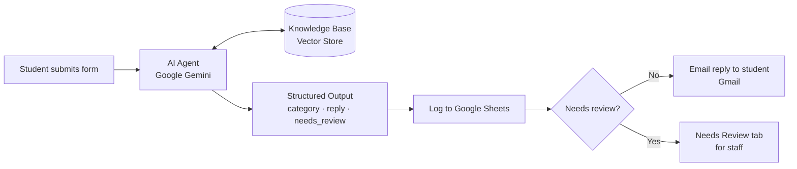
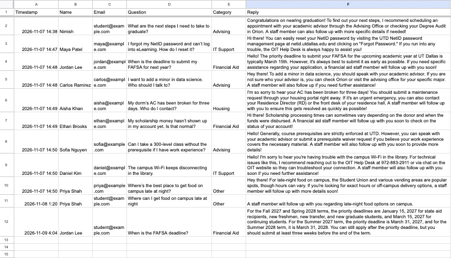
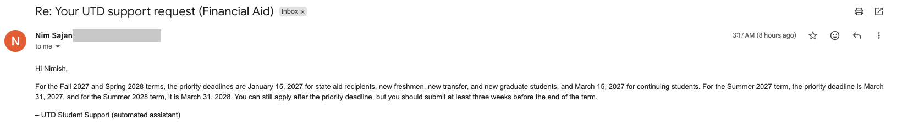

# UTD Student Support AI Agent

An AI-powered support agent that answers common student questions for UT Dallas using **retrieval-augmented generation (RAG)** over official university information. It classifies each request, writes a grounded reply, logs the ticket, emails the student, and routes anything it can't answer to a human review queue.

Built with **n8n**, **Google Gemini**, **Google Sheets**, and **Gmail**.

🎥 **Demo video:** [Watch the 2-minute demo](PASTE_YOUR_VIDEO_LINK_HERE)



---

## The Problem

University support offices get flooded with the same questions: password resets, financial aid deadlines, housing maintenance, advising. Generic AI chatbots can answer them, but they often **hallucinate**, inventing deadlines, phone numbers, or policies that sound right but aren't. For a student, a wrong financial aid deadline can cost real money.

## The Solution

This agent only answers from a knowledge base built from **official UT Dallas web pages**. If the answer isn't there, it says a staff member will follow up and flags the request for human review instead of guessing.

---

## How It Works



1. **Form intake:** A student submits their name, email, and question through an n8n form.
2. **Retrieval (RAG):** The AI agent searches a vector store of official UTD information (IT, financial aid, housing, advising) using Gemini embeddings.
3. **Grounded answer:** Gemini writes a reply using *only* the retrieved facts and is instructed never to invent dates, phone numbers, emails, or URLs.
4. **Structured output:** The agent returns clean JSON: `category`, `reply`, and `needs_review`.
5. **Logging:** Every request is appended to a Google Sheet (timestamp, student, question, category, reply).
6. **Routing:**
   - ✅ Answerable → the student gets an automatic email reply via Gmail.
   - ⚠️ Not answerable / "Other" → logged to a **Needs Review** tab for a staff member.

---

## Results: Before vs. After RAG

| Question | Before RAG | After RAG |
|---|---|---|
| "When is the FAFSA deadline?" | Vague ("typically March 15th"); missed the January 15 deadline for new students | Exact priority deadlines by student type and term, from the official UTD Financial Aid site |
| "Where can I get late-night food on campus?" | Made up details about campus food options | "A staff member will follow up." Flagged for human review instead of guessing |

- **Category accuracy:** 100% on an 8-question test set covering IT Support, Financial Aid, Housing, Advising, and Other, including intentionally ambiguous questions.




---

## Tech Stack

| Tool | Purpose |
|---|---|
| **n8n** (self-hosted) | Workflow automation and AI agent orchestration |
| **Google Gemini** | Chat model (reasoning and replies) and embeddings |
| **Simple Vector Store** | In-memory vector database for RAG |
| **Recursive Character Text Splitter** | Chunks the knowledge base (500 chars, 50 overlap) |
| **Structured Output Parser** | Forces JSON output (`category`, `reply`, `needs_review`) |
| **Google Sheets API** | Ticket logging and review queue |
| **Gmail API** | Automatic email replies |
| **Google OAuth 2.0** | Secure connection to Google services |

---

## Run It Yourself

1. Install [Node.js](https://nodejs.org) (v22 or newer) and start n8n:
   ```bash
   npx n8n
   ```
2. Open `http://localhost:5678` and import `student-support-agent.json` (**⋯ → Import → From File**).
3. Add your own credentials:
   - **Google Gemini API key** from [Google AI Studio](https://aistudio.google.com)
   - **Google Sheets + Gmail OAuth** from a Google Cloud project (enable the Sheets, Drive, and Gmail APIs)
4. Create a Google Sheet with two tabs (`Sheet1` and `Needs Review`), each with headers:
   `Timestamp | Name | Email | Question | Category | Reply`
5. Run the **knowledge base loader** branch (the Manual Trigger) to load the vector store.
6. Run the form trigger and submit a question.

> **Note:** The Simple Vector Store lives in memory, so re-run the loader after every n8n restart.

---

## Knowledge Base Sources

All answers are grounded in information from official UT Dallas pages:

- [OIT NetID Self-Service](https://oit.utdallas.edu/netid/self-service)
- [UTD Library FAQ: NetID login help](https://utdallas.libanswers.com/faq/145887)
- [UTD Financial Aid](https://finaid.utdallas.edu) (home and deadlines pages)
- [UTD University Housing](https://housing.utdallas.edu) (home and housing offices pages)
- [UTD Undergraduate Catalog](https://catalog.utdallas.edu) (academic policies and minors)

*This is a student portfolio project and is not affiliated with or endorsed by UT Dallas. Information was accurate as of November 2026.*

---

## What I Learned

- **Hallucination is the main risk with AI agents.** The baseline version gave confident but incomplete or invented answers. Adding retrieval and strict instructions fixed this.
- **Structured outputs make AI usable in real systems.** Forcing JSON allowed clean logging, routing, and email automation.
- **Human-in-the-loop design matters.** Flagging uncertain answers for staff is safer than letting the AI guess.
- **Debugging real integrations:** resolved a Node.js version mismatch, retired Gemini model versions, OAuth setup, and sheet column mapping issues.

## Next Steps

- Move from the in-memory vector store to a **persistent vector database** (e.g., Supabase, Pinecone, or Qdrant)
- Load knowledge directly from live UTD web pages or Google Docs instead of pasted text
- Add more departments (registrar, career center, parking)
- Add a confidence score and analytics dashboard for staff

---

**Built by Nimish Sajan**, Computer Information Systems @ UT Dallas
